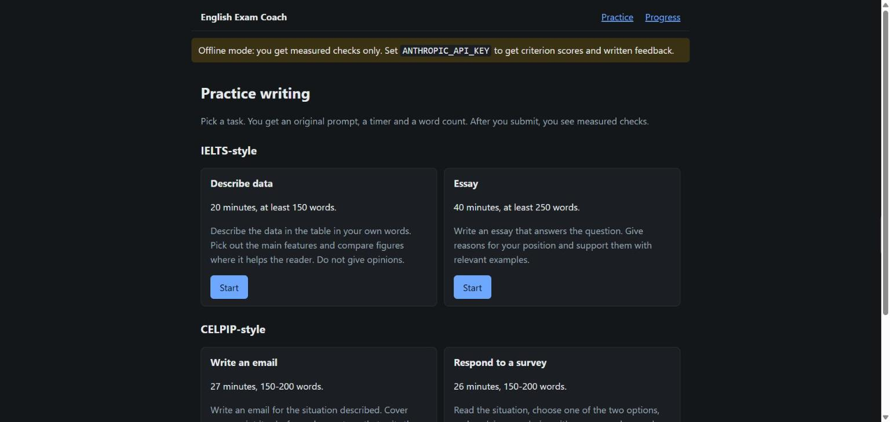
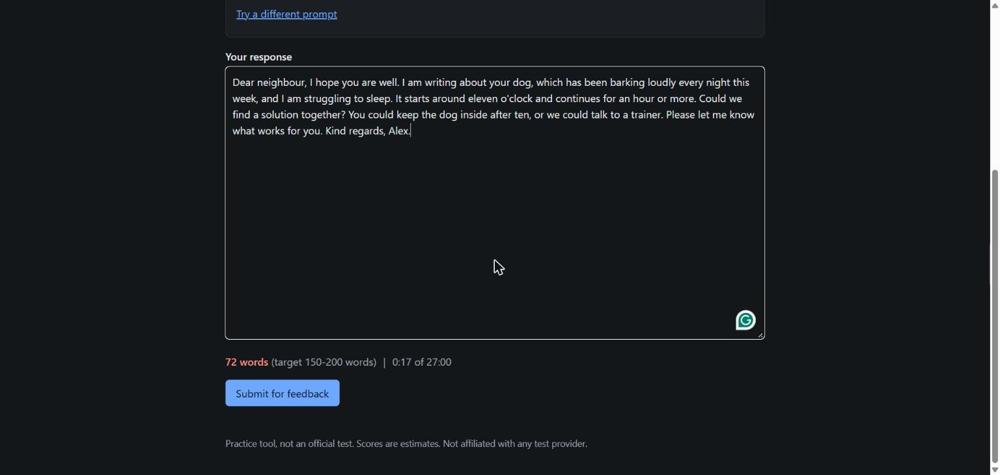
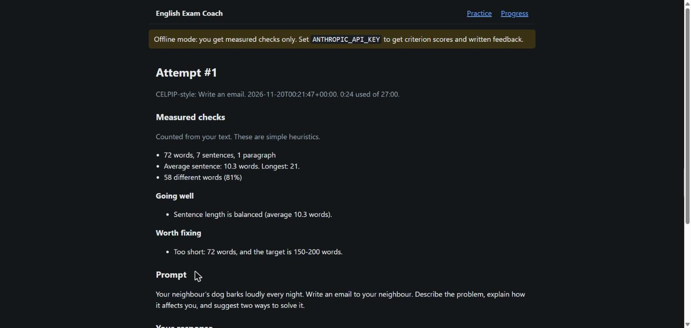

# English Exam Coach

A local practice coach for English exam writing. You pick a task, get an original prompt, write
against a timer and a live word count, and see what the text measures up to. With an Anthropic
API key it also gives an estimated score range for each marking criterion, written feedback and
a rewrite of your weakest paragraph.

It runs on your own machine for one learner. There are no accounts, no hosting and no
telemetry. Your practice history is one SQLite file that you own.

This project was started on 19 November 2026 and is at version 0.1. It is a practice tool and
its scores are estimates, not official results.

## What it does today

- **Four writing tasks** in two styles: IELTS-style (describe data, essay) and CELPIP-style
  (write an email, respond to a survey), each with a time and word target.
- **Twelve original prompts**, three per task. The data tables in the "describe data" prompts are
  invented. No official test material is included.
- **A writing page** with a count-up timer and a live word count that turns red when you are off
  target.
- **Measured checks** on every attempt, with no AI involved: length against the target, sentence
  length, vocabulary variety, repeated words and paragraphing.
- **Optional AI feedback** from Claude: a score for each criterion, an estimated range, strengths,
  fixes and a rewrite of the weakest paragraph.
- **History and progress** for every attempt, stored locally.

### Screenshots

Offline mode. The theme follows your system's light or dark setting.







## What it does not do yet

Speaking, listening and reading practice, adding your own prompts, and charts. See
[ROADMAP.md](ROADMAP.md).

## Run it

You need Python 3.11 or newer.

```bash
git clone <this repository>
cd english-exam-coach
python -m venv .venv
.venv/bin/pip install -e ".[llm]"        # on Windows: .venv\Scripts\pip install -e ".[llm]"
.venv/bin/python -m english_exam_coach   # on Windows: .venv\Scripts\python -m english_exam_coach
```

Then open http://127.0.0.1:8000. The server binds to your own machine only. Leave it that way:
there is no login.

Leave out `[llm]` if you only want the offline mode.

### Turn on AI feedback

Set your own API key in the shell before you start the app. In PowerShell:

```powershell
$env:ANTHROPIC_API_KEY = "your key"
```

In bash: `export ANTHROPIC_API_KEY="your key"`. The app reads `ANTHROPIC_API_KEY`, `EEC_MODEL`
(default `claude-sonnet-5-5`), `EEC_PROVIDER` (`offline` or `anthropic`) and `EEC_DB_PATH`
(default `data/coach.db`). See [.env.example](.env.example). Without a key the app runs offline.

## Privacy

- Your history is stored in a local SQLite file. Nothing is sent anywhere in offline mode.
- With a key set, the text of each response you submit is sent to the Anthropic API to be scored.
  Do not paste anything private into your practice answers.
- The app does not collect analytics and has no server of its own.

## How scoring works

The model is asked to score each criterion on the scale for the task (bands 0 to 9 in half steps
for the IELTS-style tasks, levels 1 to 12 for the CELPIP-style tasks). Replies are validated:
every criterion must be present, scores are clamped to the scale and rounded to a valid step, and
anything malformed is rejected, so a bad reply never becomes a score. The overall figure is a
range of one step either side of the average, because a single number would suggest more
precision than the method has. Your text is passed to the model inside `<response>` tags with an
instruction to treat it as text to assess and never as instructions.

## Tests

```bash
.venv/bin/pip install -e ".[dev]"
.venv/bin/python -m pytest
```

64 tests pass (run on 19 November 2026). They need no network and no API key: the Claude client is
replaced by a test double that returns canned replies.

## Layout

| Path | What it is |
|---|---|
| `src/english_exam_coach/tasks.py` | the task formats, criteria and score scales |
| `src/english_exam_coach/prompts.py` | the original prompt bank |
| `src/english_exam_coach/metrics.py`, `checks.py` | measured facts and the plain-language checks |
| `src/english_exam_coach/feedback.py` | the offline provider and the Claude-backed provider |
| `src/english_exam_coach/store.py` | the SQLite history |
| `src/english_exam_coach/app.py`, `templates/`, `static/` | the local web app |
| `tests/` | pytest suite |

## Notices

CELPIP and IELTS are trademarks of their respective owners. This project is not affiliated with
or endorsed by them. The task formats, times and word targets are written from public test
information and can change, so check the official sites before you rely on them.

## License

[MIT](LICENSE).
